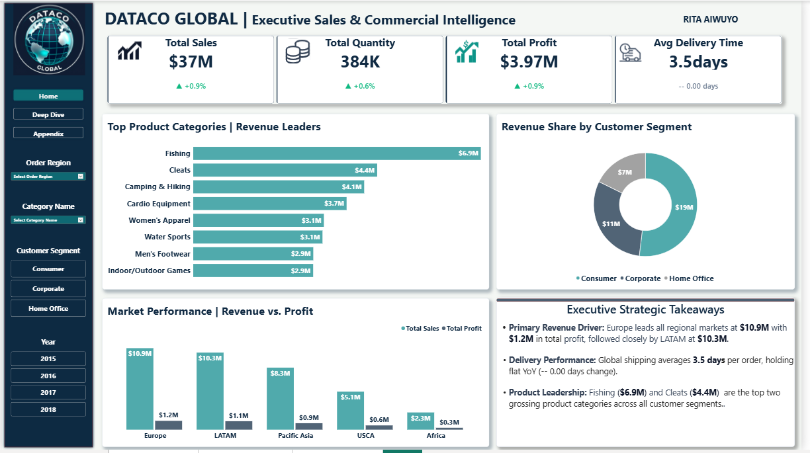
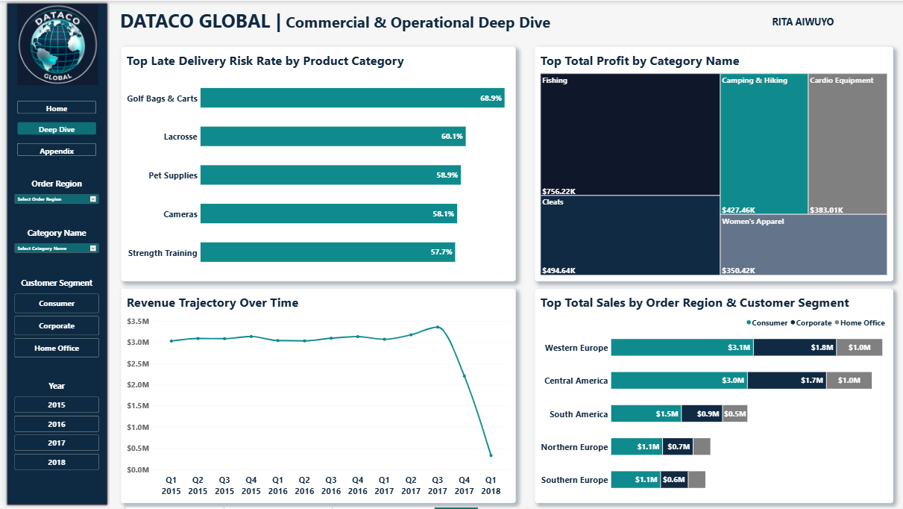
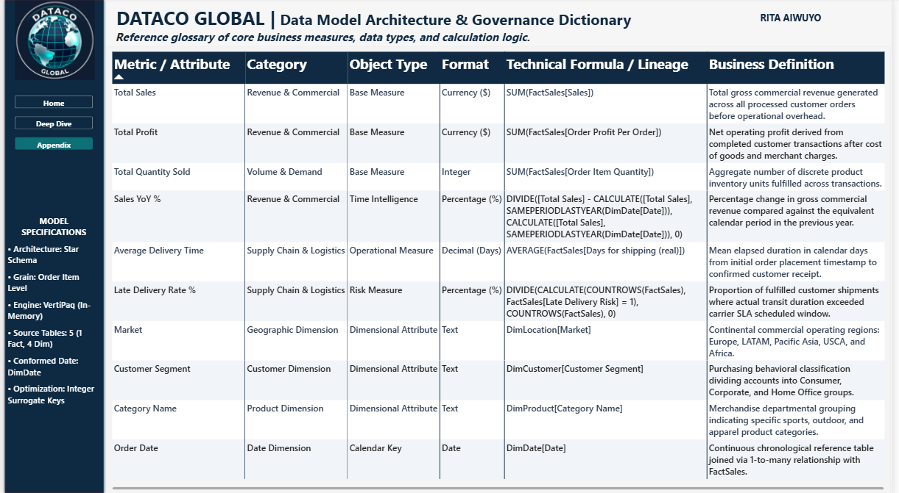

# DataCo Global | Commercial & Operational Supply Chain Intelligence

[](https://powerbi.microsoft.com/)
[](https://learn.microsoft.com/en-us/dax/)
[](https://learn.microsoft.com/en-us/power-bi/guidance/star-schema)

An end-to-end Power BI executive business intelligence solution analyzing over **180,500 transaction records** and **384,000+ fulfilled units** from the DataCo Global supply chain network[cite: 3].

This project bridges **commercial supply chain optimization** with the diagnostic discipline of **epidemiological surveillance**—applying systematic indicator surveillance, root-cause bottleneck isolation, and enterprise data governance to support C-suite decision-making.

---

## 📌 Executive Summary & Key Results

| Metric | Value | Business Context |
| :--- | :--- | :--- |
| **Gross Commercial Sales** | **$36.78M** | Total processed transaction revenue across 5 global markets |
| **Net Operating Profit** | **$3.97M** | Total operating contribution post fulfillment and freight costs |
| **Total Units Fulfilled** | **384,079** | Total discrete product items shipped across retail tiers |
| **Average Delivery Duration** | **3.50 Days** | Baseline transit duration from order placement to delivery |
| **Niche Supply SLA Risk** | **Up to 68.9%** | Severe logistical delays isolated in specific merchandise lines |

---

## 🖥️ Dashboard Architecture & Visual Design

### Page 1: Executive Sales & Commercial Intelligence
* **C-Suite Situational Triage:** High-level KPI summary cards tracking macro volume ($37M Sales, 384K Units, $3.97M Profit, 3.5 Days Fulfillment) with Year-over-Year (YoY) baseline indicators[cite: 3].
* **Geographic Volume Anchors:** Evaluates performance across 5 global operating regions, identifying **Europe ($10.9M)** and **LATAM ($10.3M)** as core revenue drivers[cite: 3].
* **Margin Health Context:** Product category volume rankings (*Fishing* at $6.9M, *Cleats* at $4.4M) equipped with on-demand profit tooltips to audit quality of earnings without visual clutter[cite: 3].



---

### Page 2: Commercial & Operational Deep Dive
* **Supply Chain Risk Surveillance:** Uncovers operational friction hidden beneath global averages—isolating high-risk fulfillment lines where categories like **Golf Bags & Carts (68.9%)** and **Lacrosse (60.1%)** frequently breach carrier SLA windows[cite: 4].
* **Profitability Contribution:** Treemap distribution highlighting core operating margin anchors across high-margin product lines[cite: 4].
* **Demand Trajectory & Segmentation:** Multi-year chronological quarterly trendline cross-filtered across *Consumer*, *Corporate*, and *Home Office* customer segments[cite: 4].



---

### Page 3: Data Model Architecture & Governance Dictionary
* **Enterprise Auditability:** A complete, in-report metric glossary classifying object types, data types, and copy-pasteable DAX calculations[cite: 2].
* **Technical Specifications:** Explicit documentation of the dimensional Kimball model, order-item transaction grain, and in-memory engine optimization[cite: 2].



---

## 🏗️ Data Architecture & Modeling

The semantic data model is structured in a canonical **Kimball Star Schema** joined via single-direction `1-to-Many (1:*)` relationships, ensuring high VertiPaq in-memory compression, rapid query traversal, and zero risk of cartesian fan-out inflation.

```text
       ┌──────────────┐          ┌──────────────┐
       │ DimCustomer  │          │  DimProduct  │
       └──────┬───────┘          └──────┬───────┘
              │ (1)                     │ (1)
              │                         │
              │ (*)                     │ (*)
       ┌──────┴─────────────────────────┴──────┐
       │               FactSales               │
       │     (Grain: Individual Order Item)    │
       └──────┬─────────────────────────┬──────┘
              │ (*)                     │ (*)
              │                         │
              │ (1)                     │ (1)


Transaction Grain: Distinct row per purchased order-item line (FactSales ID / Order Item Id).

Zero Duplication: Validated 180,519 unique fact rows against order line totals to prevent multi-item order inflation.

Conformed Date Dimension: Continuous chronological date table enabling dynamic time intelligence (SAMEPERIODLASTYEAR).

📐 Core DAX Implementations
1. Late Delivery Rate %
Late Delivery Rate % = 
DIVIDE(
    CALCULATE(
        COUNTROWS(FactSales), 
        FactSales[Late Delivery Risk] = 1
    ),
    COUNTROWS(FactSales),
    0
)

2. Total Sales & YoY Growth %
Total Sales = SUM(FactSales[Sales])

Sales YoY % = 
VAR CurrentSales = [Total Sales]
VAR PriorYearSales = CALCULATE([Total Sales], SAMEPERIODLASTYEAR(DimDate[Date]))
RETURN
DIVIDE(CurrentSales - PriorYearSales, PriorYearSales, 0)

3. Average Fulfillment Transit Duration
Average Delivery Time = AVERAGE(FactSales[Shipment Days (Actual)])


🩺 The Transferable Bridge: Supply Chain to Health Data Analytics
As a pharmacist with postgraduate training in epidemiology, this project demonstrates core analytical competencies directly transferable to public health surveillance, healthcare monitoring & evaluation (M&E), and epidemiological research:

Indicator Surveillance & Triage: Identifying high delivery risk (68.9%) in niche supply lines mirrors isolating vulnerable demographic cohorts or elevated antimicrobial resistance (AMR) infection rates.

Root-Cause Diagnostic Analysis: Deconstructing headline metrics into operational drivers prevents ecological fallacies—ensuring interventions target systemic bottlenecks rather than broad aggregates.

Data Governance & Integrity: Documenting calculations in a data catalog is identical to clinical trial auditability and public health disease registry standards, where metric ambiguity can compromise outcomes.

🛠️ Tools & Technologies
Business Intelligence: Microsoft Power BI Desktop

Analytical Modeling: DAX (Data Analysis Expressions), Time Intelligence Functions

Data Transformation: Power Query (M), Schema Normalization, Type Casting

Architecture: Kimball Star Schema, Fact/Dimension Separation, VertiPaq Engine

Source Dataset: DataCo Global Supply Chain B2C Dataset (180,519 records)

👤 Author
Rita Orobosa Aiwuyo, PharmD

Pharmacist | Health Data Analyst | MPH (Epidemiology) Candidate
